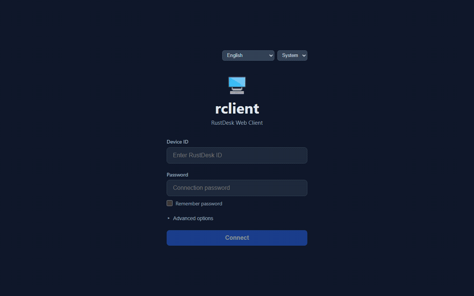

# rclient

**Your computers, in any browser.**

rclient is an open-source web client for [RustDesk](https://rustdesk.com/). It
speaks RustDesk's protocol on your behalf, through **your own relay**, so you can
control a machine from a browser on a computer where you cannot install anything.

[](https://github.com/linkzy/rustdesk-custom-web-client/actions/workflows/ci.yml)
[](./LICENSE)
[](https://github.com/linkzy/rustdesk-custom-web-client/issues?q=is%3Aissue+is%3Aopen+label%3A%22good+first+issue%22)
[](https://github.com/linkzy/rustdesk-custom-web-client/releases)



<sub>Recorded from a live session against a **throwaway test host on the demo
relay** (a clock and a plain shell, no real machine or credentials), with the
browser app driving it end to end: connect, then typed text landing in the remote
terminal. Audio is not included — that host has no sound device.
[Still frame](./docs/assets/demo.png) · [the same session, with stats](./docs/assets/demo-session.png)</sub>

> **Try it: [rclient-demo.linkzy.dev](https://rclient-demo.linkzy.dev)**
>
> A demo instance runs there, separate from anyone's private deployment. It uses
> its own relay, so point your RustDesk at that relay first — only the machine you
> want to control needs this, the browser side is already configured:
>
> 1. RustDesk → **Network** (next to your ID) → **ID Server** = the demo relay
>    hostname shown on the demo page.
> 2. **Key** = the demo's public key, also shown on the demo page.
> 3. Apply, wait for the status to go green, then enter your machine ID and
>    password in the form.
>
> A machine still on RustDesk's public network will not be found — they are
> separate relays. Anyone who already runs a RustDesk server can enter their own
> under **Advanced options** instead, and never needs the demo's relay.
>
> ✅ **The demo has been verified end to end** — a real RustDesk host driven from a
> browser through the public URL: login, live video, and keyboard and mouse input
> arriving on the remote machine. It is still one shared relay on one small server,
> so expect it to be slower than your own. What that verification did and did not
> cover is in [`deploy/DEMO.md`](./deploy/DEMO.md).
>
> Running your own is the documented path: [`deploy/DEMO.md`](./deploy/DEMO.md) is a
> generic recipe — its own relay, its own key, its own tunnel, nothing shared with
> your real deployment.

---

## Why this exists

RustDesk's native apps must be installed on every device you connect *from*.
That is fine for your own laptop and useless for a friend's machine, a locked-down
work computer, or a phone. rclient closes that gap: the controlling side is a web
page.

The project exists because the official RustDesk web client did not work well with
self-hosted relays.

---

## What works

| | |
|---|---|
| **Video** | H264, VP9, VP8 and AV1 decoded with the browser's [WebCodecs](https://developer.mozilla.org/en-US/docs/Web/API/WebCodecs_API) `VideoDecoder` |
| **Input** | Keyboard and mouse, including key layouts and Caps Lock (fixed in v0.1.1) |
| **Audio** | The host's audio, Opus via WebCodecs `AudioDecoder` — silent on browsers without it |
| **Session** | Fullscreen, fit-to-window / 1:1 scaling, a live FPS/latency overlay |
| **Relay** | Per-connection relay overrides under Advanced options |
| **Privacy** | The password is only stored if you tick "Remember password" |

Keyboard shortcuts like Ctrl+C / Ctrl+V are **not** forwarded yet, and there is no
file transfer, clipboard sync or multi-monitor. The full list is below.

---

## Quickstart

Fastest path: a relay you already run, plus the two containers.

```bash
git clone https://github.com/linkzy/rustdesk-custom-web-client
cd rustdesk-custom-web-client

cp .env.example .env        # fill in HBBS_HOST, HBBR_HOST, SERVER_KEY
docker compose -f docker-compose.prod.yml up -d
```

Open the port from `WEB_PORT` (80 by default) — or put HTTPS in front of it, which
WebCodecs requires. Then enter the remote machine's RustDesk ID and password.

No relay yet? [`docs/DEPLOYMENT.md`](./docs/DEPLOYMENT.md) starts one from scratch and
covers HTTPS, operating and troubleshooting. For the code itself:
[`docs/DEVELOPMENT.md`](./docs/DEVELOPMENT.md); for every document:
[`docs/README.md`](./docs/README.md).

---

## Requirements

**On the machine you connect to:** RustDesk installed and running, pointed at your
relay.

**To host rclient:** a machine running Docker and Docker Compose, and a domain name
(or a free [Cloudflare Tunnel](https://developers.cloudflare.com/cloudflare-one/connections/connect-networks/)).
Node 22 is only needed to build from source; `docker-compose.prod.yml` uses the
published images.

**In the browser:** a current Chromium, Firefox or Safari, served over HTTPS.
rclient has no WASM fallback — it depends on the browser's own WebCodecs:

| Capability | Needed for | Notes |
|---|---|---|
| `VideoDecoder` | Video | In current Chromium, Firefox and Safari |
| `AudioDecoder` | Audio | Newer; where it is missing, audio is skipped and everything else works |
| `AudioContext` | Audio playback | Widely available |
| Secure context (HTTPS or `localhost`) | Both | Browsers only expose WebCodecs over HTTPS |

Whether a given browser version works depends on its WebCodecs implementation, so
check its own support tables rather than a version number here.

---

## Deploying it yourself

The full guide — relay setup, every environment variable, HTTPS options, operating
and troubleshooting — is in **[docs/DEPLOYMENT.md](docs/DEPLOYMENT.md)**. The short
version:

1. **A host** with RustDesk installed, pointed at your relay (Settings → Network:
   the relay address and its public key).
2. **A relay** — yours, or a public one. rclient ships none.
3. **rclient**:

   ```bash
   cp .env.example .env      # HBBS_HOST, HBBR_HOST, SERVER_KEY
   docker compose -f docker-compose.prod.yml up -d
   ```

4. **TLS in front** of the `web` container (Cloudflare Tunnel or any
   reverse proxy) — browsers only expose WebCodecs over HTTPS.

Never publish the gateway port (4000): it holds the session keys. A reverse proxy
that drops the WebSocket upgrade is the most common failure; the page loads and
`/ws` closes immediately.

---

## How it fits together

```
Browser ──HTTPS/WSS──> web (nginx) ──> gateway (Node.js) ──RustDesk protocol──> your relay ──> host
```

- **Gateway** (`gateway/`) holds the RustDesk session encryption, speaks the binary
  protocol and bridges it to your relay. The browser never sees a session key.
- **Web** (`web/`) decodes video and audio with WebCodecs, draws to a canvas and
  captures input.
- **The relay** (hbbs for rendezvous, hbbr for the stream) is yours and is not
  part of this repository.

Design notes and the full browser↔gateway API: [`docs/ARCHITECTURE.md`](./docs/ARCHITECTURE.md).
Protocol details: [`docs/PROTOCOL.md`](./docs/PROTOCOL.md).

---

## Privacy and security

**The password.** Not saved by default: it stays in the page's memory, goes to the
gateway over HTTPS, and the gateway sends the remote machine a hash
(`SHA256(SHA256(password + salt) + challenge)`), never the password itself. It is
written to `localStorage` **only** if you tick **Remember password**, and only
after the connection succeeds. Unticking deletes it. On a shared computer, leave it
unticked.

**What the browser keeps.** Without that opt-in, only preferences:
`rclient_target_id`, the Advanced-options overrides
(`rclient_hbbs_host`, `rclient_hbbr_host`, `rclient_server_key`), and UI flags
(`rclient_advanced_open`, `rclient_debug_visible`, `rclient_fit`).

**Logging.** The gateway logs connection events — target ID, relay addresses,
handshake stages, frame rates — and never the password. A verbose per-keystroke log
exists in the code but is commented out.

**Analytics.** The project adds none, and sets no cookies. The two hosted instances
are behind Cloudflare, which injects its Web Analytics beacon into the page; a
self-hosted deployment does not get that from this repository.

**Deployment.** Never publish the gateway port (4000) — the gateway holds the
session keys. Use HTTPS. The encryption handshake happens in the gateway, so the
browser is not a place keys can leak from.

Full threat model: [`SECURITY.md`](./SECURITY.md).

---

## Limitations

Honest list; each of these is a known gap, not a bug report you need to file.

| Limitation | Detail |
|---|---|
| Keyboard shortcuts | Ctrl+C / Ctrl+V / Ctrl+A and friends are not forwarded. Open bug (KI-006). |
| File transfer | Not implemented. |
| Clipboard | No sync between browser and host. |
| Multiple monitors | Only the first display is shown. |
| Mobile | Touch/mouse works; there is no on-screen keyboard. |
| Audio | Skipped entirely in browsers without WebCodecs `AudioDecoder`. |
| Reconnect | A dropped socket ends the session; you reconnect by hand. |
| One session per tab | The gateway keeps one session per WebSocket. |
| Force relay | Always through the relay — no direct P2P fallback. |

`docs/KNOWN_ISSUES.md` has the confirmed bugs with root causes;
`docs/ARCHITECTURE.md` explains why each limitation is where it is.

---

## FAQ

**Do I need to run my own relay?**
You need *a* relay: your own, or a public one. Running your own is the point —
lower latency, your data on your server. rclient ships no relay configuration.

**Is the demo working?**
Yes — verified end to end: a real RustDesk host, on the demo's own relay, driven
from a browser through the public URL (login, live video, keyboard and mouse input
arriving on the remote machine). It needs two minutes of setup from you first: set
your RustDesk's **ID Server** to the demo relay hostname shown on the demo page, and
its **Key** to the demo's public key. See [`deploy/DEMO.md`](./deploy/DEMO.md), which
also covers what the verification did not include (audio, and load beyond a single
visitor).

**Where is the password stored?**
Nowhere, unless you opt in with "Remember password" — then in your browser's
`localStorage`, and never on the server. See [Privacy](#privacy-and-security).

**Why not just use RustDesk's own web client?**
It did not work well with self-hosted relays; that is why this exists.

**Is it tested?**
Yes. The full suite in both packages (currently 52 gateway tests and 108 web),
plus lint, typecheck and a production build, runs on every pull request in
[CI](https://github.com/linkzy/rustdesk-custom-web-client/actions/workflows/ci.yml),
and there are end-to-end tests against the fake host. The unit tests pin the pure
parts (hashing, framing, key mapping, storage, translation catalogues); a real
session needs a RustDesk host, and that has been verified too — see
[the demo note](#why-this-exists).

**Can I use it on my phone?**
Partly. Mouse and touch work; typing on the remote machine does not yet.

**It says "wrong password" but I am sure it is right.**
That is the RustDesk password on the host, not a login — rclient has no accounts.
Check it in RustDesk itself; hosts can have both a permanent and a one-time password.

**It says the machine is offline.**
RustDesk is not running on the host, or it is pointing at a different relay than
`HBBS_HOST`. Both ends must use the same server and key.

**It connects, then sits at "waiting for image".**
Rendezvous worked but the relay stream did not — usually the relay's `21117`/`21119`
ports are unreachable, or the host and the gateway are on different relays. The
step-by-step is in [`docs/DEPLOYMENT.md`](./docs/DEPLOYMENT.md#troubleshooting).

**No video at all.**
Either the browser lacks WebCodecs `VideoDecoder`, or the page is not on HTTPS.
The browser console logs the codec the decoder tried to initialise.

**No audio, but video is fine.**
The browser lacks WebCodecs `AudioDecoder`, or the host sends more than two
channels. Audio is skipped without breaking the session.

**Why does it need HTTPS?**
Browsers only expose WebCodecs in a secure context. `localhost` counts; a LAN IP
over plain HTTP does not.

**How do I report a bug or ask a question?**
Bugs: the [bug report form](https://github.com/linkzy/rustdesk-custom-web-client/issues/new?template=bug_report.yml).
Questions: [Discussions](https://github.com/linkzy/rustdesk-custom-web-client/discussions).
Security: privately, per [`SECURITY.md`](./SECURITY.md).

---

## Roadmap

Three milestones, published as issues and tracked in
[`docs/TASKS.md`](./docs/TASKS.md):

- **v0.2.0 — Community-ready**: log rotation, memory limits and healthchecks in the
  shipped compose files, structured logging, firewall and reverse-proxy guidance,
  friendlier errors, audio controls, a shortcut help overlay.
- **v0.3.0 — Everyday remote desktop**: reconnect, saved hosts, clipboard sync,
  forwarded shortcuts, mobile keyboard.
- **v0.4.0 — Bigger features**: file transfer, multi-monitor, i18n, themes.

**Seven issues are marked [`good first issue`](https://github.com/linkzy/rustdesk-custom-web-client/issues?q=is%3Aissue+is%3Aopen+label%3A%22good+first+issue%22)**
and are deliberately left for contributors: compose log rotation and healthchecks
(#2), audio mute and volume (#5), a shortcut help overlay (#6), friendlier errors
(#7), screenshots for the docs (#8), reverse-proxy examples (#10), and a theme
toggle (#20). Comment on one to claim it.

---

## Contributing

Read [`CONTRIBUTING.md`](./CONTRIBUTING.md) first — it covers what a good report
and PR look like. Then
[`docs/DEVELOPMENT.md`](./docs/DEVELOPMENT.md) to run both packages, and
[`docs/AI_GUIDELINES.md`](./docs/AI_GUIDELINES.md) for the protocol pitfalls that
break sessions in ways that look unrelated.

AI-assisted contributions are welcome; you are responsible for what you submit.

## License

[MIT](./LICENSE) © Danilo Cavalcante (linkzy)
